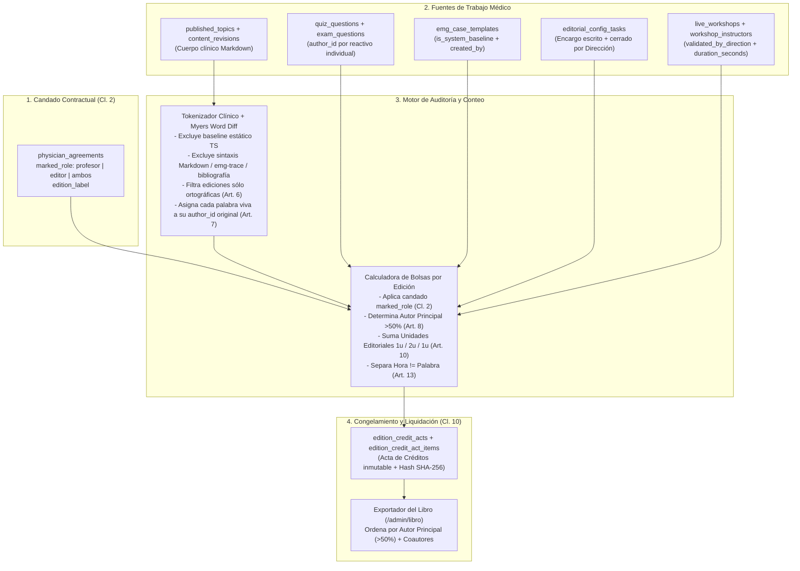

# Auditoría Técnica del Sistema de Conteo de Participación, Versionado y Atribución Autoral en ElectroDX

**Fecha de auditoría:** 12 de noviembre de 2026  
**Alcance:** Inspección integral de extremo a extremo (Esquemas PostgreSQL/Supabase, funciones RPC `SECURITY DEFINER`, servicios TypeScript, motores de fusión de contenido, exportador editorial del libro y componentes React de edición/administración).  
**Marco normativo de referencia (Criterio de Verdad):**
- `docs/legal/medicos/contrato-prestacion-servicios-medicos.md` (Cláusulas 1 a 11: candado de bolsas por rol, Docencia, Obra, Labor Editorial, Libro y Acta de Créditos).
- `docs/legal/medicos/reglamento-editorial-y-libro.md` (Artículos 1 a 17: reglas de conteo de palabras, exclusiones ortográficas/estructurales, coautoría sin duplicación, umbral `>50%` para Autor Principal, tabulador de Unidades Editoriales y separación *Hora ≠ Palabra*).
- `docs/legal/medicos/anexo-participacion.md` (§1 a §7: rol marcado, alcances A/B/C/D, tabla económica y reglas de cálculo por bolsa).

---

## 1. Dictamen Ejecutivo Global

> **Veredicto de la Auditoría:** **NO CUMPLE (Brecha Crítica de Trazabilidad, Conteo y Atribución).**  
> Actualmente, la aplicación **no posee ningún motor de conteo de palabras, ni atribución diferencial por autor (diff palabra por palabra), ni libro mayor (ledger) de Unidades Editoriales, ni candados por rol contractual (`marked_role`)**. El sistema opera mediante **sobrescritura destructiva del estado publicado** (`published_topics`, `published_quizzes`, `emg_case_templates`) combinada con instantáneas completas en `content_revisions` que **atribuyen el 100% del documento al autor de cada revisión aprobada** (incluso si solo cambió una letra o subió un enlace) y un bug en la función RPC `review_revision` que **asigna `last_edited_by = auth.uid()` al administrador/revisor que aprueba la propuesta, en lugar del médico autor**.

### Resumen de Cumplimiento Contractual por Eje

| Regla Contractual / Editorial | Referencia Legal | Estado en Código / BD | Nivel de Riesgo |
| :--- | :--- | :--- | :--- |
| **1. Conteo de palabras publicadas de la edición** | Contrato Cl. 7 · Reglamento Art. 5–6 | **Inexistente.** No hay columna `word_count` ni función que limpie Markdown/código/citas antes de contar. | **CRÍTICO** |
| **2. Exclusión de ortografía, puntuación, formato y orden** | Reglamento Art. 6 | **Incumplido.** Cambiar 1 letra genera una fila `approved` en `content_revisions` con todo el tema y otorga crédito de coautoría en el libro. | **CRÍTICO** |
| **3. Coautoría sin duplicar palabras y Autor Principal (`>50%`)** | Reglamento Art. 7 y Art. 8 | **Incumplido.** No existe motor de *diff* por tokens/palabras. El exportador del libro ordena autores **alfabéticamente** (`localeCompare`), nunca por `>50%` de aporte. | **CRÍTICO** |
| **4. Atribución de `last_edited_by` al médico autor** | Reglamento Art. 3 · Contrato Cl. 10 | **Bug activo.** En `review_revision` (`20260924190000_topic_media_pdf_support.sql:245`), `last_edited_by = auth.uid()` graba al **revisor que aprueba**, robando el crédito principal en UI y Libro. | **CRÍTICO** |
| **5. Candado de bolsas según rol firmado (`marked_role`)** | Contrato Cl. 2 · Anexo §1 y §5 | **Incumplido.** `physician_agreements.marked_role` (`profesor` / `editor` / `ambos`) jamás se consulta en servicios editoriales, talleres ni cálculos. | **ALTO** |
| **6. Tabulador de Unidades Editoriales (Reactivo=1u, Caso=2u, Config=1u)** | Contrato Cl. 8 · Reglamento Art. 10 | **Incumplido.** `quiz_questions` se borra y recrea en bloque (`DELETE` + `INSERT`) sin `author_id` por pregunta; `exam_questions` no tiene `created_by`; no existe tabla para tareas de configuración. | **CRÍTICO** |
| **7. Separación *Hora ≠ Palabra* y validación de Docencia** | Contrato Cl. 6 · Reglamento Art. 13–14 | **Parcial / Ambiguo.** Videos incrustados en temas no guardan duración ni autor; talleres (`live_workshops`) tienen `duration_minutes DEFAULT 90`, pero carecen de sello `validated_by_direction`. | **ALTO** |
| **8. Congelamiento de edición y Acta de Créditos inmutable** | Contrato Cl. 10 · Reglamento Art. 3 y 16 | **Inexistente.** No existe tabla `edition_credit_acts` ni snapshot inmutable por edición (`edition_label`). | **CRÍTICO** |

---

## 2. Diagnóstico Técnico por Archivo y Tabla SQL

### 2.1. Esquema de Base de Datos y Migraciones (`supabase/migrations/`)

#### A. `published_topics`, `published_modules` y `content_revisions`
- **Archivos inspeccionados:**
  - `supabase/migrations/20260911000000_neurosafemx_core_schema.sql` (líneas 97–184)
  - `supabase/migrations/20260918180000_fix_review_revision_slug_and_media.sql` (líneas 31–195)
  - `supabase/migrations/20260924190000_topic_media_pdf_support.sql` (líneas 61–252)
- **Hallazgos técnicos exactos:**
  1. **Ausencia de autoría granular en `published_topics`:** La tabla `public.published_topics` solo almacena tres columnas de trazabilidad:
     - `source_revision_id UUID REFERENCES public.content_revisions(id)`
     - `published_by UUID REFERENCES public.profiles(id)`
     - `last_edited_by UUID REFERENCES public.profiles(id)`
     En cada `ON CONFLICT (id) DO UPDATE`, `published_by` se conserva (`published_topics.published_by` original), pero `content`, `description`, `clinical_pearls`, `key_points`, `media`, `source_revision_id` y `last_edited_by` **se sobrescriben por completo**.
  2. **Bug crítico de suplantación involuntaria en `review_revision` (`20260924190000_topic_media_pdf_support.sql`, líneas 127, 211 y 245):**
     Cuando un colaborador (`rev.author_id`) envía una propuesta y un administrador/editor ejecuta `review_revision(p_revision_id, 'approved', ...)`, la función SQL ejecuta:
     ```sql
     INSERT INTO public.published_topics (
       id, module_id, parent_id, sort_order, slug, title, title_en,
       description, description_en, content, content_en,
       clinical_pearls, clinical_pearls_en, key_points, key_points_en,
       video_url, media, version, source_revision_id, published_by, last_edited_by, published_at
     ) VALUES (
       ...,
       v_version, rev.id, auth.uid(), auth.uid(), now()
     )
     ON CONFLICT (id) DO UPDATE SET
       ...,
       source_revision_id = rev.id,
       last_edited_by = auth.uid(),
       published_at = now();
     ```
     **Consecuencia:** `published_by` (en creación) y `last_edited_by` (en creación y actualización) se asignan a **`auth.uid()` (el administrador que presionó "Aprobar")** y **NO a `rev.author_id` (el médico que escribió el tema)**. Lo mismo ocurre en `published_modules` (línea 110) y `published_quizzes` (líneas 132 y 140).
  3. **Pérdida silenciosa de `references` en el bloque `ELSE` de `review_revision` (`20260924190000_topic_media_pdf_support.sql`, líneas 183–191):**
     Si el payload de la revisión no trae el objeto anidado `p->'media'`, la función construye `v_media` con `videoUrls`, `youtubeUrls`, `vimeoUrls`, `embedUrls`, `imageUrls` y `pdfUrls`, **omitiendo la clave `'references'`**, lo que borra las referencias bibliográficas personalizadas del tema en base de datos.
  4. **Temas base estáticos sin línea base en `content_revisions`:**
     Los módulos originales del diplomado viven en archivos estáticos TypeScript (`src/content/modules/modulo-01-*.ts` a `modulo-10-*.ts`) y en `src/content/lessonExpansions.ts`. Ninguno de esos temas tiene una revisión inicial (`version = 0` o `baseline`) en `content_revisions`. Cuando el primer médico edita un tema estático, su fila en `content_revisions` guarda en `payload.content` las miles de palabras estáticas preexistentes más su cambio, aparentando en la base de datos que él redactó todo el texto desde cero.

#### B. Cuestionarios de Tema (`published_quizzes` y `quiz_questions`) y Banco de Exámenes (`exam_questions`)
- **Archivos inspeccionados:**
  - `supabase/migrations/20260911000000_neurosafemx_core_schema.sql` (líneas 186–224)
  - `supabase/migrations/20260912100000_custom_exams_and_questions.sql` (líneas 1–98)
  - `supabase/migrations/20260924190000_topic_media_pdf_support.sql` (líneas 120–163)
- **Hallazgos técnicos exactos:**
  1. **`quiz_questions` carece de columna `author_id` / `created_by`:** La tabla `public.quiz_questions` solo tiene `(id, quiz_id, sort_order, type, stem, stem_en, image_url, image_alt, options, explanation, explanation_en, difficulty)`. No registra quién redactó cada reactivo individual.
  2. **Destrucción total e inserción masiva al editar un cuestionario (`20260924190000_topic_media_pdf_support.sql`, líneas 143–161):**
     Cada vez que se aprueba una revisión de tipo `quiz`, el RPC ejecuta:
     ```sql
     DELETE FROM public.quiz_questions WHERE quiz_id = v_quiz_id;
     INSERT INTO public.quiz_questions (...) SELECT ... FROM jsonb_array_elements(COALESCE(p->'questions', '[]'::jsonb));
     ```
     Si el Médico A creó un cuestionario con 10 reactivos (`10 unidades editoriales` según Art. 10 del Reglamento) y el Médico B agrega 1 reactivo adicional (o corrige una falta de ortografía en el reactivo 1), el sistema **elimina los 10 reactivos de A**, los vuelve a insertar con nuevos `UUID`s y sobrescribe `published_quizzes.source_revision_id` y `last_edited_by`. Es imposible saber en `quiz_questions` que 10 reactivos son de A y 1 reactivo es de B.
  3. **`exam_questions` carece por completo de trazabilidad de autor (`20260912100000_custom_exams_and_questions.sql`, líneas 15–31):**
     La tabla del banco global de exámenes (`public.exam_questions`) ni siquiera tiene columna `created_by`, `author_id` o `updated_by`. Cualquier reactivo creado directamente en el banco de exámenes (mediante `quizService.saveQuestion` en `src/services/quizService.ts:104-129`) es **100% anónimo** en la base de datos y no puede sumar `1 unidad editorial` a ningún médico.

#### C. Casos Clínicos EMG (`emg_case_templates`)
- **Archivos inspeccionados:**
  - `supabase/migrations/20260913120000_emg_case_templates.sql` (líneas 1–47)
  - `src/services/emgExerciseService.ts` (líneas 176–265)
- **Hallazgos técnicos exactos:**
  1. La tabla `public.emg_case_templates` tiene `created_by UUID REFERENCES public.profiles(id)`, pero **no tiene `last_edited_by`, ni tabla de historial de versiones por caso, ni vínculo con `content_revisions` al editarse directamente**.
  2. En `src/services/emgExerciseService.ts` (`saveCaseTemplate`, líneas 234–245):
     - Cuando se crea un caso (`INSERT`), se guarda `created_by: user?.id ?? null`.
     - Cuando otro médico o editor actualiza el mismo caso (`UPDATE`, líneas 241–245), se sobrescriben `title`, `patient_data`, `expected_Preset_id`, `ncs_findings`, `emg_findings`, `correct_diagnosis`, `explanation`, `custom_nerves`, `custom_muscles`, `reference_list` e `images`, **sin guardar quién hizo la edición ni conservar la versión previa**.
     - Además, los casos estáticos base en `src/data/caseTemplates/` (`ALL_CASE_TEMPLATES`) se fusionan en memoria con `created_by: undefined` (`emgExerciseService.ts:132`). Si un editor abre uno de esos casos base y lo guarda en Supabase, entra por la rama `if (existing)` o `else` (si no estaba en BD) y **se registra con `created_by = user.id`**, adjudicándole `2 unidades editoriales` por un caso preexistente de la plataforma.

#### D. Talleres, Clases Grabadas y Compromisos Docentes (`live_workshops`, `workshop_instructors`, `topic_teaching_commitments`, `workshop_video_progress`)
- **Archivos inspeccionados:**
  - `supabase/migrations/20260911000000_neurosafemx_core_schema.sql` (líneas 293–337)
  - `supabase/migrations/20260926224440_topic_teaching_commitments.sql` (líneas 1–138)
  - `supabase/migrations/20261102180000_workshop_video_watch_progress.sql` (líneas 1–187)
  - `src/services/topicTeachingService.ts` (líneas 1–535)
  - `src/services/videoProgressService.ts` (líneas 1–339)
- **Hallazgos técnicos exactos:**
  1. **Sin validación formal de Dirección Académica para la bolsa de Docencia:**
     La **Cláusula 6 del Contrato** y el **Anexo §5** establecen que la bolsa de Docencia se reparte según:
     $$\text{Pago por docencia} = \text{Bolsa de docencia} \times \frac{\text{Sesiones que impartió y la Dirección validó}}{\text{Sesiones computables de la cohorte}}$$
     Sin embargo, `public.live_workshops` solo tiene un campo `status workshop_status DEFAULT 'scheduled'` (`'scheduled' | 'live' | 'completed' | 'cancelled'`) y `topic_teaching_commitments` tiene `status TEXT DEFAULT 'committed'` (`'committed' | 'completed' | 'cancelled'`). **No existe ninguna columna `validated_for_payroll BOOLEAN`, `validated_by UUID`, `validated_at TIMESTAMPTZ` ni `edition_id`** que certifique que la sesión cumplió los 3 requisitos del Anexo §1.A (impartida en fecha, material entregado y grabación disponible).
  2. **Co-instrucción sin factor de prorrateo:**
     `public.workshop_instructors` permite múltiples instructores por sesión (`role: 'lead' | 'assistant' | 'guest'`), pero ni la tabla ni el código definen si una sesión con 2 instructores suma `1.0` o `0.5` sesiones a cada médico, o si solo computa el `'lead'`.

### 2.2. Servicios TypeScript y Componentes Frontend

| Archivo | Líneas Clave | Diagnóstico de Comportamiento Actual |
| :--- | :--- | :--- |
| `src/services/editorialService.ts` | `475–521`, `714–792` | `getApprovedRevisionCredits()` devuelve todas las filas `approved` de `content_revisions` sin filtrar ediciones ortográficas ni calcular palabras netas. `createTopicDirectly()` y `updateTopicDirectly()` tienen un *fallback* (líneas 748 y 777) que hace `.upsert()` directo sobre `published_topics`, saltándose `content_revisions` si falla el RPC. |
| `src/services/contentMerge.ts` | `42–150`, `228–268` | Fusiona en tiempo de ejecución 3 capas: (1) módulos estáticos TypeScript (`src/content/modules/`), (2) filas de `published_topics` en Supabase y (3) expansiones estáticas de `src/content/lessonExpansions.ts` (`applyLessonExpansions`). Si un tema tiene una fila en `published_topics`, **ignora la expansión estática** (`if (!topic.contributionMeta)` en línea 231) y muestra en el banner únicamente `lastEditedBy` (línea 86). |
| `src/components/editorial/TopicContribution.tsx` | `11–39` | `ContributionBanner` muestra solo **un nombre** (`meta.lastEditedBy` → `"Actualizado por la comunidad · {authorName} · v{version}"`). Como `review_revision` guarda `last_edited_by = auth.uid()`, ¡el banner público de la lección muestra el nombre del **administrador que aprobó**, no del médico que escribió el tema ni de los coautores! |
| `src/components/editorial/QuickTopicMaterialModal.tsx` | `144–270` | Cuando un médico usa el botón rápido para agregar 1 video, 1 PDF, 1 imagen, 1 perla clínica o 1 trazo simulado (`:::emg-trace{...}:::`), la función clona **todo el payload del tema** (`topicToRevisionPayload(targetTopic)`), le adjunta el recurso y crea una revisión `action: 'update'` con `authorId: user.id`. Al aprobarse, esa revisión en `content_revisions` contiene el 100% del texto del tema bajo el `author_id` de quien solo subió una imagen o un enlace de video. |
| `src/pdf/textbook/loadTextbookContributors.ts` y `textbookCredits.ts` | `13–30`, `32–141` | Construye los créditos del Libro combinando `published_topics.last_edited_by` (`role: 'editor'`, rango 3), `published_topics.published_by` (`role: 'publisher'`, rango 2) y `content_revisions.author_id` (`role: 'contributor'`, rango 1 = `"Revisión"`). Ordena a los autores de cada tema y capítulo **por orden alfabético** (`a.name.localeCompare(b.name, 'es')`, línea 121), ignorando por completo la regla del **Autor Principal (`>50%` de palabras)** del Art. 8 del Reglamento Editorial. |
| `src/components/admin/AdminTextbookExportPage.tsx` | `271–315`, `717–738` | Permite al administrador desactivar manualmente a cualquier autor con un clic (`disabledAuthorIds` guardado en `localStorage` del navegador), sin vínculo con el **Acta de Créditos** ni registro de auditoría en base de datos. |

---

## 3. Evaluación de los 6 Escenarios Borde (Simulación de Edición Colaborativa)

A continuación se presenta la matriz comparativa de los **6 escenarios de prueba solicitados**, contrastando la exigencia del **Contrato / Reglamento Editorial** frente a lo que ocurre **exactamente hoy en el código fuente**:

### 3.1. Tabla Comparativa de los 6 Escenarios Borde

| Escenario Colaborativo | Regla del Contrato y Reglamento Editorial | Qué ocurre HOY en la Aplicación (Código y BD) | Brecha / Efecto en Pago y Crédito |
| :--- | :--- | :--- | :--- |
| **1. Creación base** (`Médico A` redacta un tema completo desde cero) | **Art. 5 y 6:** Cuentan las palabras publicadas del cuerpo clínico que permanezcan al congelar la edición, excluyendo formato/estructura. | `RevisionEditorPage.tsx` guarda el Markdown crudo en `content_revisions.payload.content`. Al aprobarse (`review_revision`), se copia a `published_topics.content`, pero **`published_by` y `last_edited_by` quedan con el `auth.uid()` del revisor**. No existe cálculo de `word_count` en SQL ni TS. Si se contara `content.split(/\s+/)`, incluiría símbolos Markdown (`##`, `**`, tablas `\|---\|`), bloques `:::emg-trace{...}:::` y citas PDF legadas. | **Alta:** Médico A pierde el crédito de `published_by`/`last_edited_by` frente al revisor; no hay conteo limpio de palabras. |
| **2. Edición mínima** (`Médico B` cambia 1 letra o corrige ortografía/puntuación en el tema de `Médico A`) | **Art. 6:** *"No generan palabras: corrección ortográfica, de puntuación o de estilo que no reescriba el contenido; formato, diseño..."* (`0 palabras` para B). | `RevisionEditorPage.tsx` carga todo el texto de A (`loadSourceTopic`), B cambia 1 letra y envía. `content_revisions` inserta una fila nueva con `author_id = B` y **el 100% del texto de A en `payload.content`**. Al aprobarse, `published_topics.source_revision_id` apunta a la revisión de B. `getApprovedRevisionCredits()` y `textbookCredits.ts` registran a B como coautor del tema y del capítulo del Libro con igual peso que A. Si B es admin y usa `updateTopicDirectly`, `last_edited_by` pasa a B. | **Crítica (Robo de autoría / Sobrepago):** 1 letra le da a B coautoría en el libro y una instantánea con el 100% de las palabras del tema en `content_revisions`. |
| **3. Coautoría por párrafo / reescritura clínica** (`Médico C` agrega un párrafo o reescribe una sección dentro del tema de `Médico A`) | **Art. 7:** Cada quien suma solo las palabras que escribió y siguen publicadas; ningún pasaje se cuenta dos veces.<br>**Art. 8:** Quien supere `>50%` de las palabras del tema aparece primero como **Autor Principal**. | `RevisionDiff.tsx` (`líneas 64–112`) solo hace `JSON.stringify(a) !== JSON.stringify(b)` y muestra dos bloques `<pre>` lado a lado ("Actual" vs "Propuesto") sin calcular *diff* por palabra. En BD quedan dos filas `approved` en `content_revisions`: la de A (ej. 1,000 palabras) y la de C (1,200 palabras = 1,000 de A + 200 de C). No hay motor que reste las 1,000 palabras de A ni que calcule que A tiene `83.3%` (`>50%`, Autor Principal) y C tiene `16.7%`. En el libro (`textbookCredits.ts:121`), si `"Carlos"` va antes que `"Alberto"` en el alfabeto, **C aparece primero que A**. | **Crítica (Duplicación de palabras e inversión de Autor Principal):** Imposible distinguir las 200 palabras netas de C; el orden autoral en el libro es alfabético, violando el Art. 8. |
| **4. Bibliografía y referencias** (`Médico D` agrega o edita la sección de bibliografía del tema) | **Art. 5, 6 y 10:** La bolsa de Obra remunera palabras redactadas de los temas; el formato y las listas de metadatos bibliográficos no deben inflar artificialmente el conteo de prosa clínica. | En `RevisionEditorPage.tsx` (`líneas 393–423`), las referencias se guardan como arreglo JSON en `payload.references` y `payload.media.references` (`{ authors, title, journal, year, url }`), separado de `payload.content`. Sin embargo: (1) al enviar esa revisión, D genera una fila en `content_revisions` con `author_id = D` que incluye todo el `payload.content` del tema; (2) si un médico pega las referencias como texto dentro del Markdown de `content`, no hay filtro que separe la sección `## Bibliografía` o `## Referencias` del conteo de palabras de Obra. | **Media-Alta:** Editar solo la lista JSON de referencias convierte a D en coautor del tema completo en `content_revisions`; pegar citas en Markdown infla palabras de Obra. |
| **5. Imágenes y recursos gráficos** (`Médico E` sube o inserta una imagen/diagrama clínico en el tema) | **Art. 3, 6 y 10:** Las imágenes no son palabras ni están en el tabulador de Unidades Editoriales (Art. 10), salvo como parte integral de un Caso Clínico (2 u.) o Reactivo (1 u.), aunque merecen crédito de figura si son de autoría propia. | Cuando E sube una imagen desde `QuickTopicMaterialModal.tsx` (`líneas 199–220`), `uploadTeachingFile(user.id, 'image', file)` guarda el archivo en el bucket `course-images` bajo la ruta `${userId}/${uuid}.${ext}` e inyecta en `caption` el texto `"— Aportado por ${authorName}"`. **Pero:** (1) el objeto `TopicMedia.imageUrls` (`{ src, alt, caption }`) no tiene campo estructurado `authorId` ni `uploadedBy`; (2) si E sube la imagen desde `RevisionEditorPage.tsx` (`líneas 376–385`), ni siquiera se agrega el nombre al `caption`; y (3) como `QuickTopicMaterialModal` guarda una revisión `update` del tema completo con `authorId = E`, ¡subir 1 imagen registra a E en `content_revisions` como autor de una revisión aprobada del tema! | **Alta:** No existe tabla de autoría de activos gráficos (`media_assets`), y el flujo rápido (`QuickTopicMaterialModal`) contamina `content_revisions` haciendo que quien sube 1 imagen figure como coautor textual del tema. |
| **6. Videos y ponderación por duración** (`Médico F` sube video de **10 min** vs. `Médico G` sube video de **1 h 30 min / 90 min**) | **Cláusula 6, Anexo §5 y Reglamento Art. 13–14 (*Hora ≠ Palabra*):**<br>1. Las horas de clase y sus grabaciones pertenecen **exclusivamente a la bolsa de Docencia** y **NO suman palabras en Obra ni unidades en Labor Editorial**.<br>2. La bolsa de Docencia se paga por **sesión impartida y validada por la Dirección**, no por subir enlaces de video sueltos a un tema. | Existen **2 flujos inconexos** en la app:<br>**Flujo 1 — Video incrustado en tema (`QuickTopicMaterialModal.tsx` / `TopicVideoEditorSection.tsx`):** Guarda solo `{ title, driveId / videoId / embedUrl }` en `published_topics.media`. **No existe columna ni campo `duration_seconds` o `duration_minutes`**. El video de 10 min de F y el de 90 min de G se guardan exactamente igual (como 1 enlace en JSONB), sin duración ni `author_id` propio, pero ambos crean una revisión `approved` del tema a nombre de F y G.<br>**Flujo 2 — Taller / Clase (`live_workshops` + `workshop_video_progress`):** `live_workshops` tiene `duration_minutes INT DEFAULT 90`. Tanto una sesión de 10 min como una de 90 min cuentan como `1 fila` en `live_workshops`, sin ponderación por minutos reales ni sello de validación de Dirección Académica. Además, para grabaciones en Google Drive (`attestDriveRecordingAttendance` en `videoProgressService.ts:183`), `durationSeconds` se guarda como `0` porque el iframe de Drive no expone duración al DOM. | **Crítica:** (1) En temas, los videos de 10 min y 90 min no guardan duración y contaminan la autoría editorial del tema; (2) en talleres, no existe validación de Dirección ni distinción entre un micro-video de 10 min y una sesión sincrónica de 90 min. |

---

### 3.2. Trazado Detallado en Código de los 6 Escenarios

#### Escenario 1 y 2: Por qué 1 letra de edición o la aprobación del revisor distorsiona toda la autoría
1. En `src/components/editorial/RevisionEditorPage.tsx` (`líneas 73–142`), cuando el Médico B abre un tema existente del Médico A para corregir una tilde, `loadSourceTopic()` descarga el tema completo desde `published_topics` (o desde el árbol estático TypeScript) y lo copia íntegro en el estado local `payload.content`.
2. Al guardar y enviar (`líneas 220–233`), `saveRevision` inserta en `public.content_revisions` un registro nuevo con `author_id = B.id` y `payload` conteniendo las 2,500 palabras de A más la tilde de B.
3. Cuando el Administrador X aprueba la revisión en `AdminReviewQueue.tsx` (`línea 179`), se invoca `review_revision(p_revision_id, 'approved', notes)` en `supabase/migrations/20260924190000_topic_media_pdf_support.sql`:
   - Línea 245: `last_edited_by = auth.uid()` sobrescribe `published_topics.last_edited_by` con el UUID del **Administrador X**.
   - En la vista del alumno (`src/components/editorial/TopicContribution.tsx:19-33`), `ContributionBanner` consulta `getProfileById(meta.lastEditedBy)` y renderiza: `"Actualizado por la comunidad · Administrador X"`. El Médico A desaparece del encabezado del tema.
   - En el exportador del Libro (`src/pdf/textbook/loadTextbookContributors.ts:18-24` y `src/pdf/textbook/textbookCredits.ts:44-82`), `getApprovedRevisionCredits()` recupera todas las revisiones `approved` de ese `target_topic_id`. Tanto el Médico A como el Médico B (por 1 tilde) y el Administrador X (`last_edited_by`) entran al arreglo de autores del tema y del capítulo.

#### Escenario 3: Inexistencia de motor de *diff* léxico y fallo del umbral `>50%` (Art. 7 y Art. 8)
- El **Artículo 7 del Reglamento Editorial** ordena:
  > *"Cuando dos o más personas redacten o reescriban el mismo tema: 1. Cada quien suma las palabras que escribió y siguen publicadas al cerrar la edición. 2. Ningún pasaje se cuenta dos veces."*
- El **Artículo 8 del Reglamento Editorial** ordena:
  > *"Aparece primero como Autor Principal quien haya escrito más de la mitad (> 50 %) de las palabras del tema. Si nadie supera ese umbral, la Dirección Académica define el orden según el aporte de cada quien."*
- En la aplicación actual:
  - El único archivo con la palabra `Diff` es `src/components/admin/RevisionDiff.tsx`, el cual **no utiliza ningún algoritmo de diferencia de textos** (como Myers diff, `diff-match-patch` o tokenización léxica). Únicamente compara `JSON.stringify(current[key]) !== JSON.stringify(proposed[key])` (línea 65) y pinta el texto viejo a la izquierda y el texto nuevo a la derecha.
  - En `src/pdf/textbook/textbookCredits.ts` (línea 121):
    ```ts
    return [...byId.values()].sort((a, b) => a.name.localeCompare(b.name, 'es'));
    ```
    El orden de aparición de los autores en cada lección, capítulo y portada del Libro **es estrictamente alfabético por nombre de pila/título**, violando frontalmente el Artículo 8 del Reglamento Editorial.

#### Escenario 6: Análisis de Videos (10 min vs. 90 min) y el Principio *Hora ≠ Palabra*
- Si el **Médico F** sube un video explicativo de `10 minutos` y el **Médico G** sube una clase magistral de `1 hora con 30 minutos (90 minutos)`:
  1. **Si lo suben dentro de un tema (`RevisionEditorPage` o `QuickTopicMaterialModal`):**
     - `src/utils/mediaValidation.ts` extrae únicamente `{ title, driveId }` o `{ title, videoId, startTime }`.
     - **No existe campo `duration_seconds` en `TopicMedia` (`src/types/database.ts:39-48`).**
     - Ambos videos carecen de duración en la base de datos.
     - Peor aún: al guardarse mediante una revisión de tema (`revisionType: 'topic'`), el sistema registra a F y G en `content_revisions` como editores del tema, **mezclando material audiovisual con la trazabilidad editorial del texto**, lo cual contradice el **Artículo 13 del Reglamento Editorial** (*"Las horas de clase y sus grabaciones pertenecen a la bolsa de Docencia y se rigen por el contrato y el Anexo. No suman palabras en Obra ni unidades en Labor Editorial"*).
  2. **Si lo registran como Taller / Clase en Vivo o Grabada (`live_workshops`):**
     - La tabla `public.live_workshops` (`20260911000000_neurosafemx_core_schema.sql:295`) tiene `duration_minutes INT NOT NULL DEFAULT 90`.
     - El contrato (Cláusula 6 y Anexo §5) paga la bolsa de Docencia **por sesión impartida y validada por la Dirección** (`sesiones que impartió y la Dirección validó ÷ sesiones computables de la cohorte`), no por minuto de video. Sin embargo, para que una sesión sea computable y validada por la Dirección Académica, la base de datos necesita saber:
       - Duración real del recurso o sesión (`actual_duration_seconds`).
       - Si cumple el umbral mínimo de una sesión docente (p. ej., una cápsula de 10 min vs. una sesión de 60–90 min, o su equivalencia fraccionaria si Dirección lo aprueba como media sesión / cápsula).
       - Quién de Dirección Académica la validó (`validated_by`, `validated_at`, `computable_sessions_weight`). Hoy ninguno de estos tres controles existe en `live_workshops` ni en `topic_teaching_commitments`.

---

## 4. Validación de Reglas de Negocio y Candados Contractuales (Sección C)

### 4.1. Candado de Bolsas por Rol (`marked_role` — Cláusula 2 del Contrato y Anexo §1)
- **Regla contractual (Cláusula 2):**
  > *"Su participación económica se limita a las bolsas que correspondan al papel marcado en el Anexo: Profesor → participa solo en la bolsa de Docencia. Editor → participa solo en las bolsas de Obra y de Labor Editorial. Profesor y editor → participa en las tres bolsas. Las bolsas cerradas para su papel no generan derecho a pago aunque realice actividades fuera de su encargo, salvo que antes se firme un nuevo Anexo."*
- **Estado actual en código:**
  - En `supabase/migrations/20261029050000_physician_agreements.sql` y `src/content/legal/physicianAgreements.ts`, el campo `marked_role` aún no está tipado como columna explícita de enum (`'profesor' | 'editor' | 'ambos'`) con restricción sobre el cálculo de bolsas, y **ninguna consulta SQL ni servicio TypeScript verifica el convenio activo del médico** para filtrar si sus palabras suman a la bolsa de Obra, si sus unidades suman a Labor Editorial o si sus sesiones suman a Docencia.
  - **Riesgo:** Un médico contratado únicamente como `Profesor` puede editar temas o subir preguntas desde la UI (si tiene el rol técnico `contributor` o `editor` en `user_roles`) y entrar en las estadísticas editoriales sin tener bolsa de Obra ni Labor Editorial abierta en su Anexo.

### 4.2. Tabulador de Unidades Editoriales (Cláusula 8 y Reglamento Art. 10)
El **Artículo 10 del Reglamento Editorial** define taxativamente las únicas tres actividades que generan **Unidades Editoriales** para la bolsa de Labor Editorial:

| Concepto del Tabulador (Art. 10) | Valor | Estado Actual en Base de Datos y Servicios | ¿Se puede calcular hoy con exactitud? |
| :--- | :---: | :--- | :---: |
| **Reactivo de evaluación publicado** | `1 unidad` | 1. En cuestionarios de tema (`quiz_questions`), **no existe columna `author_id`**. Al aprobar una edición del quiz, `review_revision` hace `DELETE FROM public.quiz_questions WHERE quiz_id = v_quiz_id` y reinserta todas las preguntas (`20260924190000_topic_media_pdf_support.sql:143`).<br>2. En el banco global de exámenes (`exam_questions`, `20260912100000_custom_exams_and_questions.sql:15`), **tampoco existe `created_by` ni `author_id`**. | **NO (Imposible sin perder o sobrescribir autoría individual por reactivo).** |
| **Caso clínico o ejercicio EMG publicado** | `2 unidades` | 1. En `emg_case_templates` (`20260913120000_emg_case_templates.sql:8`), existe `created_by`, pero las ediciones posteriores (`emgExerciseService.ts:241`) sobrescriben el caso en el sitio sin historial.<br>2. Los 33 casos clínicos estáticos de la plataforma (`ALL_CASE_TEMPLATES`) no tienen `created_by` bloqueado en BD; si un usuario con permisos guarda cambios sobre uno, puede apropiarse del `created_by` en el primer `INSERT` a Supabase. | **PARCIAL / VULNERABLE (Riesgo de apropiación de casos estáticos y sin coautoría auditada).** |
| **Tarea de configuración encargada por escrito y cerrada por la Dirección** | `1 unidad` | **No existe tabla, modelo ni pantalla** en toda la aplicación para registrar encargos escritos de configuración ni su cierre por la Dirección Académica. | **NO (0% implementado en BD y UI).** |

### 4.3. Exclusión de Formato, Diseño, Orden y Jerarquía (Reglamento Art. 6)
- **Regla (Art. 6):** *"No generan palabras: ... formato, diseño, orden de temas o configuración de la plataforma."*
- **Estado actual:**
  - Los cambios de orden, visibilidad (`is_visible`), módulo destino (`module_id`), tema padre (`parent_topic_id`) y título corto se guardan en `public.syllabus_topic_overrides` y `public.course_modules` (`src/services/courseService.ts`), lo cual está correctamente separado de `published_topics`.
  - **Sin embargo**, cuando un editor mueve un tema de `parent_id` o cambia su `slug` o agrega saltos de línea/encabezados Markdown desde `RevisionEditorPage.tsx`, eso sí genera una fila `approved` en `content_revisions` con todo el cuerpo del tema, contaminando los créditos de Obra.

---

## 5. Brechas Críticas de Riesgo Legal y Financiero

1. **Riesgo de Sobrepago / Duplicación de Bolsa de Obra (Reglamento Art. 7):**
   Si se intenta calcular la bolsa de Obra sumando la longitud de `payload.content` de las revisiones aprobadas en `content_revisions`, un tema de `3,000 palabras` editado 5 veces (por ejemplo, para agregar un video, un PDF, una imagen, una perla y corregir una coma) sumaría `15,000 palabras` (5 veces el mismo texto), distorsionando el denominador de `"Palabras publicadas de la edición"` y despojando de su porcentaje real a los autores que redactaron temas originales sin reediciones triviales.
2. **Riesgo de Subpago y Despojo Autoral por el Bug de `last_edited_by = auth.uid()`:**
   Si por el contrario se intenta calcular la bolsa de Obra leyendo `published_topics`, el **100% de los temas aprobados mediante la cola de revisión (`AdminReviewQueue`) tienen como `last_edited_by` (y `published_by` si eran nuevos) al administrador que hizo clic en "Aprobar"**, dejando con **\$0.00 MXN y sin crédito principal** al médico autor que redactó el tema en `RevisionEditorPage`.
3. **Riesgo de Impugnación del Libro y del Acta de Créditos (Contrato Cl. 9 y 10 · Reglamento Art. 3 y 8):**
   - El libro exportado en `/admin/libro` (`AdminTextbookExportPage.tsx`) lista a los autores de cada tema y capítulo en **orden alfabético** en lugar de colocar primero al **Autor Principal (`>50%` de palabras)**.
   - Un colaborador que solo corrigió una falta de ortografía o subió un enlace de YouTube mediante `QuickTopicMaterialModal` aparece impreso como coautor del capítulo en el Libro en igualdad de condiciones con el autor que escribió 4,000 palabras clínicas.
   - No existe en la base de datos ninguna entidad que respalde la emisión del **Acta de Créditos** al congelar la edición (Cláusula 10), dejando a DeepLuxMed sin evidencia criptográfica/tabular ante una controversia en el plazo de 5 días naturales del Artículo 16.
4. **Riesgo de Pérdida Total de Autoría en Reactivos (`quiz_questions` y `exam_questions`):**
   Un médico que redacte 50 reactivos en el banco de exámenes (`exam_questions`) o que agregue reactivos a cuestionarios existentes (`quiz_questions`) que luego otro editor modifique verá su conteo reducido a **0 unidades editoriales**, porque `exam_questions` no guarda `author_id` y `review_revision` ejecuta `DELETE FROM public.quiz_questions WHERE quiz_id = v_quiz_id` en cada actualización.

---

## 6. Plan de Solución Técnica (Arquitectura SQL y Algoritmo del Acta de Créditos)

Para que ElectroDX cumpla al **100%** con el Contrato, el Anexo de Participación y el Reglamento Editorial sin fricción operativa, se diseña a continuación la arquitectura de base de datos, el motor de atribución léxica palabra por palabra y el generador automático del **Acta de Créditos**.

### 6.1. Diagrama de Arquitectura del Motor de Conteo y Atribución



---

### 6.2. Corrección de Bugs Inmediatos y Esquema SQL Propuesto (DDL Completo)

A continuación se especifica la migración SQL necesaria para:
1. Corregir `review_revision` para que atribuya `published_by` y `last_edited_by` a **`rev.author_id`** (y guarde al aprobador en `last_reviewed_by`), preserve `references` en `media`, y conserve el `author_id` individual de cada pregunta en `quiz_questions`.
2. Agregar trazabilidad individual por reactivo en `quiz_questions` y `exam_questions`, protección de casos base en `emg_case_templates`, metadatos de duración/autoría en videos e imágenes, validación de Dirección Académica en `live_workshops`, tabla de tareas de configuración (`editorial_config_tasks`), tabla de atribución de palabras por tema (`topic_word_attributions`) y tablas del **Acta de Créditos** (`edition_credit_acts`).

```sql
-- ============================================================================
-- MIGRACIÓN PROPUESTA: TRAZABILIDAD GRANULAR, CONTEO DE OBRA, UNIDADES Y ACTA
-- ============================================================================

-- 1. Asegurar rol contractual tipado en physician_agreements (Cláusula 2)
DO $$ BEGIN
  CREATE TYPE public.physician_contract_role AS ENUM ('profesor', 'editor', 'ambos');
EXCEPTION WHEN duplicate_object THEN NULL;
END $$;

ALTER TABLE public.physician_agreements
  ADD COLUMN IF NOT EXISTS marked_role public.physician_contract_role NOT NULL DEFAULT 'ambos',
  ADD COLUMN IF NOT EXISTS docencia_pool_mxn NUMERIC(12,2),
  ADD COLUMN IF NOT EXISTS obra_pool_mxn NUMERIC(12,2),
  ADD COLUMN IF NOT EXISTS editorial_pool_mxn NUMERIC(12,2);

-- 2. Corregir trazabilidad en published_topics, published_modules y published_quizzes
ALTER TABLE public.published_topics
  ADD COLUMN IF NOT EXISTS last_reviewed_by UUID REFERENCES public.profiles(id) ON DELETE SET NULL,
  ADD COLUMN IF NOT EXISTS is_static_baseline BOOLEAN NOT NULL DEFAULT FALSE,
  ADD COLUMN IF NOT EXISTS baseline_word_count INT NOT NULL DEFAULT 0,
  ADD COLUMN IF NOT EXISTS clean_word_count INT NOT NULL DEFAULT 0;

ALTER TABLE public.published_modules
  ADD COLUMN IF NOT EXISTS last_reviewed_by UUID REFERENCES public.profiles(id) ON DELETE SET NULL;

ALTER TABLE public.published_quizzes
  ADD COLUMN IF NOT EXISTS last_reviewed_by UUID REFERENCES public.profiles(id) ON DELETE SET NULL;

-- 3. Autoría individual por reactivo (Reglamento Art. 10: Reactivo publicado = 1 unidad)
ALTER TABLE public.quiz_questions
  ADD COLUMN IF NOT EXISTS stable_question_key TEXT,
  ADD COLUMN IF NOT EXISTS author_id UUID REFERENCES public.profiles(id) ON DELETE SET NULL,
  ADD COLUMN IF NOT EXISTS last_edited_by UUID REFERENCES public.profiles(id) ON DELETE SET NULL,
  ADD COLUMN IF NOT EXISTS is_system_baseline BOOLEAN NOT NULL DEFAULT FALSE,
  ADD COLUMN IF NOT EXISTS created_at TIMESTAMPTZ NOT NULL DEFAULT now(),
  ADD COLUMN IF NOT EXISTS updated_at TIMESTAMPTZ NOT NULL DEFAULT now();

ALTER TABLE public.exam_questions
  ADD COLUMN IF NOT EXISTS author_id UUID REFERENCES public.profiles(id) ON DELETE SET NULL,
  ADD COLUMN IF NOT EXISTS last_edited_by UUID REFERENCES public.profiles(id) ON DELETE SET NULL,
  ADD COLUMN IF NOT EXISTS is_system_baseline BOOLEAN NOT NULL DEFAULT FALSE,
  ADD COLUMN IF NOT EXISTS approved_for_editorial_units BOOLEAN NOT NULL DEFAULT TRUE;

-- 4. Protección de línea base y coautoría en Casos Clínicos EMG (Art. 10: Caso = 2 unidades)
ALTER TABLE public.emg_case_templates
  ADD COLUMN IF NOT EXISTS is_system_baseline BOOLEAN NOT NULL DEFAULT FALSE,
  ADD COLUMN IF NOT EXISTS last_edited_by UUID REFERENCES public.profiles(id) ON DELETE SET NULL,
  ADD COLUMN IF NOT EXISTS approved_by UUID REFERENCES public.profiles(id) ON DELETE SET NULL,
  ADD COLUMN IF NOT EXISTS approved_at TIMESTAMPTZ,
  ADD COLUMN IF NOT EXISTS edition_label TEXT;

-- 5. Tabla para "Tarea de configuración encargada por escrito y cerrada por la Dirección" (Art. 10 = 1 unidad)
CREATE TABLE IF NOT EXISTS public.editorial_config_tasks (
  id UUID PRIMARY KEY DEFAULT gen_random_uuid(),
  edition_label TEXT NOT NULL,
  assigned_to UUID NOT NULL REFERENCES public.profiles(id) ON DELETE RESTRICT,
  title TEXT NOT NULL,
  written_brief TEXT NOT NULL,            -- Constancia del encargo por escrito
  deliverable_reference TEXT,             -- PR, ruta, módulo o evidencia entregada
  editorial_units NUMERIC(5,2) NOT NULL DEFAULT 1.00 CHECK (editorial_units = 1.00),
  status TEXT NOT NULL DEFAULT 'assigned' CHECK (status IN ('assigned', 'submitted', 'closed_by_direction', 'cancelled')),
  assigned_by UUID NOT NULL REFERENCES public.profiles(id) ON DELETE RESTRICT,
  assigned_at TIMESTAMPTZ NOT NULL DEFAULT now(),
  closed_by_direction UUID REFERENCES public.profiles(id) ON DELETE SET NULL,
  closed_at TIMESTAMPTZ,
  direction_notes TEXT
);

-- 6. Validación de Dirección Académica y duración real en Docencia (Cláusula 6 y Art. 13-14)
ALTER TABLE public.live_workshops
  ADD COLUMN IF NOT EXISTS edition_label TEXT,
  ADD COLUMN IF NOT EXISTS actual_duration_seconds INT,
  ADD COLUMN IF NOT EXISTS recording_duration_seconds INT,
  ADD COLUMN IF NOT EXISTS computable_session_value NUMERIC(4,2) NOT NULL DEFAULT 1.00,
  ADD COLUMN IF NOT EXISTS material_delivered BOOLEAN NOT NULL DEFAULT FALSE,
  ADD COLUMN IF NOT EXISTS recording_available BOOLEAN NOT NULL DEFAULT FALSE,
  ADD COLUMN IF NOT EXISTS validated_by_direction UUID REFERENCES public.profiles(id) ON DELETE SET NULL,
  ADD COLUMN IF NOT EXISTS validated_at TIMESTAMPTZ,
  ADD COLUMN IF NOT EXISTS validation_notes TEXT;

ALTER TABLE public.workshop_instructors
  ADD COLUMN IF NOT EXISTS session_share NUMERIC(4,3) NOT NULL DEFAULT 1.000
    CHECK (session_share > 0 AND session_share <= 1.000);

-- 7. Registro de Activos Multimedia y Gráficos con Autoría y Duración (Escenarios 5 y 6)
CREATE TABLE IF NOT EXISTS public.topic_media_assets (
  id UUID PRIMARY KEY DEFAULT gen_random_uuid(),
  topic_id TEXT NOT NULL,
  module_id TEXT NOT NULL,
  asset_type TEXT NOT NULL CHECK (asset_type IN ('image', 'pdf', 'video', 'emg_trace')),
  url TEXT NOT NULL,
  title TEXT,
  caption TEXT,
  duration_seconds INT,                   -- Obligatorio para distinguir videos de 10m vs 90m
  uploaded_by UUID NOT NULL REFERENCES public.profiles(id) ON DELETE RESTRICT,
  is_own_authored_figure BOOLEAN NOT NULL DEFAULT TRUE,
  counts_as_docencia_session_id UUID REFERENCES public.live_workshops(id) ON DELETE SET NULL,
  created_at TIMESTAMPTZ NOT NULL DEFAULT now()
);

-- 8. Tabla de Atribución de Palabras por Tema y Autor (Reglamento Art. 5, 6, 7 y 8)
CREATE TABLE IF NOT EXISTS public.topic_word_attributions (
  id UUID PRIMARY KEY DEFAULT gen_random_uuid(),
  edition_label TEXT NOT NULL,
  topic_id TEXT NOT NULL,
  module_id TEXT NOT NULL,
  author_id UUID REFERENCES public.profiles(id) ON DELETE SET NULL, -- NULL = baseline estático de la plataforma
  is_platform_baseline BOOLEAN NOT NULL DEFAULT FALSE,
  surviving_words INT NOT NULL DEFAULT 0 CHECK (surviving_words >= 0),
  total_topic_authored_words INT NOT NULL DEFAULT 0,               -- Total palabras de médicos en el tema (sin baseline)
  total_topic_all_words INT NOT NULL DEFAULT 0,                    -- Total palabras del tema incluyendo baseline
  author_share_pct NUMERIC(6,3) NOT NULL DEFAULT 0,                -- % sobre palabras de médicos (Art. 8)
  is_principal_author BOOLEAN NOT NULL DEFAULT FALSE,              -- TRUE si > 50.000% (Art. 8)
  author_rank INT NOT NULL DEFAULT 99,                             -- 1 = Autor Principal, 2..N por orden de aporte
  source_revision_ids UUID[] NOT NULL DEFAULT '{}',
  computed_at TIMESTAMPTZ NOT NULL DEFAULT now(),
  UNIQUE (edition_label, topic_id, author_id)
);

-- 9. Tabla del Acta de Créditos por Edición (Contrato Cláusula 10 y Reglamento Art. 3 y 16)
CREATE TABLE IF NOT EXISTS public.edition_credit_acts (
  id UUID PRIMARY KEY DEFAULT gen_random_uuid(),
  edition_label TEXT NOT NULL UNIQUE,
  status TEXT NOT NULL DEFAULT 'draft' CHECK (status IN ('draft', 'notified', 'final_frozen')),
  total_computable_sessions NUMERIC(8,2) NOT NULL DEFAULT 0,
  total_published_words INT NOT NULL DEFAULT 0,
  total_editorial_units NUMERIC(8,2) NOT NULL DEFAULT 0,
  docencia_pool_mxn NUMERIC(12,2) NOT NULL DEFAULT 0,
  obra_pool_mxn NUMERIC(12,2) NOT NULL DEFAULT 0,
  editorial_pool_mxn NUMERIC(12,2) NOT NULL DEFAULT 0,
  snapshot_sha256 TEXT NOT NULL,
  frozen_by UUID REFERENCES public.profiles(id) ON DELETE SET NULL,
  notified_at TIMESTAMPTZ,
  objection_deadline_at TIMESTAMPTZ,      -- notified_at + INTERVAL '5 days' (Reglamento Art. 16)
  frozen_at TIMESTAMPTZ,
  created_at TIMESTAMPTZ NOT NULL DEFAULT now()
);

CREATE TABLE IF NOT EXISTS public.edition_credit_act_items (
  id UUID PRIMARY KEY DEFAULT gen_random_uuid(),
  act_id UUID NOT NULL REFERENCES public.edition_credit_acts(id) ON DELETE CASCADE,
  physician_id UUID NOT NULL REFERENCES public.profiles(id) ON DELETE RESTRICT,
  agreement_id UUID REFERENCES public.physician_agreements(id) ON DELETE SET NULL,
  marked_role public.physician_contract_role NOT NULL,
  -- Bolsa 1: Docencia (Cláusula 6)
  validated_sessions NUMERIC(8,2) NOT NULL DEFAULT 0,
  computable_sessions NUMERIC(8,2) NOT NULL DEFAULT 0, -- 0 si marked_role = 'editor'
  docencia_share_pct NUMERIC(6,3) NOT NULL DEFAULT 0,
  docencia_payout_mxn NUMERIC(12,2) NOT NULL DEFAULT 0,
  -- Bolsa 2: Obra (Cláusula 7)
  raw_surviving_words INT NOT NULL DEFAULT 0,
  computable_words INT NOT NULL DEFAULT 0,            -- 0 si marked_role = 'profesor'
  obra_share_pct NUMERIC(6,3) NOT NULL DEFAULT 0,
  obra_payout_mxn NUMERIC(12,2) NOT NULL DEFAULT 0,
  principal_author_topic_ids TEXT[] NOT NULL DEFAULT '{}',
  coauthor_topic_ids TEXT[] NOT NULL DEFAULT '{}',
  -- Bolsa 3: Labor Editorial (Cláusula 8 y Art. 10)
  published_quiz_questions INT NOT NULL DEFAULT 0,    -- x 1 u.
  published_clinical_cases INT NOT NULL DEFAULT 0,    -- x 2 u.
  closed_config_tasks INT NOT NULL DEFAULT 0,         -- x 1 u.
  raw_editorial_units NUMERIC(8,2) NOT NULL DEFAULT 0,
  computable_editorial_units NUMERIC(8,2) NOT NULL DEFAULT 0, -- 0 si marked_role = 'profesor'
  editorial_share_pct NUMERIC(6,3) NOT NULL DEFAULT 0,
  editorial_payout_mxn NUMERIC(12,2) NOT NULL DEFAULT 0,
  -- Total y firma de conformidad / plazo de 5 días
  total_payout_mxn NUMERIC(12,2) NOT NULL DEFAULT 0,
  breakdown_json JSONB NOT NULL DEFAULT '{}'::jsonb,
  UNIQUE (act_id, physician_id)
);
```

---

### 6.3. Algoritmo Exacto de Conteo de Palabras, Exclusión Ortográfica y Atribución Coautoral (Reglamento Art. 5, 6, 7 y 8)

Para resolver de raíz los **Escenarios 1, 2, 3 y 4**, el motor de conteo (`src/services/editorialAttributionEngine.ts`) debe procesar la cadena de revisiones de cada `topic_id` aplicando **4 fases deterministas**:

#### Fase 1: Sanitización Estructural y Exclusión de No-Obra (Art. 5 y 6)
Antes de tokenizar cualquier revisión o tema base, se extrae únicamente la prosa clínica elegible (`title`, `description`, `content`, `clinicalPearls`, `keyPoints`) y se eliminan todos los elementos que **no son redacción clínica**:
1. Bloques de simulador interactivo: `:::emg-trace\{[\s\S]*?\}:::` → eliminado.
2. Bloques de citación PDF legados (`stripLegacyPdfMarkdown`): `> 📄 **Recurso Clínico Docente:** ...` → eliminado.
3. Bloques de código cercados (`` ```...``` ``), etiquetas HTML (`<[^>]+>`), URLs (`https?:\/\/\S+`) y sintaxis de imágenes/enlaces Markdown (`!\[[^\]]*\]\([^)]*\)`, dejando solo el texto ancla en enlaces clínicos).
4. Sección de bibliografía incrustada en Markdown (todo texto posterior a un encabezado `^#{1,4}\s*(Bibliograf[íi]a|Referencias|Lecturas recomendadas)\b` hasta el siguiente encabezado del mismo nivel o fin de documento), ya que las referencias bibliográficas se gestionan en `media.references` y no deben inflar artificialmente las palabras de Obra.
5. Símbolos de formato Markdown (`#`, `*`, `_`, `~`, `` ` ``, `>`, `|`, separadores de tablas `:---:`) y signos de puntuación aislados.

#### Fase 2: Tokenización con Normalización Ortográfica (Art. 6)
Cada palabra restante se convierte en un token estructurado:
```ts
interface LexicalWordToken {
  rawWord: string;         // Palabra tal como aparece (ej. "conducción")
  skeleton: string;        // Normalización sin tildes, en minúsculas y sin signos (ej. "conduccion")
  ownerAuthorId: string;   // 'PLATFORM_BASELINE' o UUID del médico que introdujo este token
  revisionId: string;      // ID de la revisión donde nació este token
}
```
- **Cómo bloquea el Escenario 2 (Edición de 1 letra, tilde, mayúscula o puntuación — Art. 6):**
  - Los signos de puntuación (`,`, `.`, `;`, `:`, `¿`, `?`) no son tokens de palabra, por lo que agregar o quitar puntuación produce **0 tokens nuevos**.
  - Si el Médico B corrige `"conduccion"` → `"conducción"`, o `" Miopatia"` → `"Miopatía"`, o cambia mayúsculas/minúsculas, el `skeleton` fonético/ortográfico (`normalizeNFD(word).replace(/[\u0300-\u036f]/g, '').toLowerCase()`) o una distancia de Levenshtein `= 1` dentro de una ventana de contexto idéntica (donde los tokens vecinos izquierdo y derecho no cambiaron) se clasifica como **corrección ortográfica/tipográfica in-situ**.
  - Cuando se detecta una corrección ortográfica in-situ, el token actualiza su `rawWord` a `"conducción"`, pero **conserva el `ownerAuthorId` del Médico A**. El Médico B suma **exactamente `0 palabras`** por esa corrección, cumpliendo de forma matemática el **Artículo 6 del Reglamento Editorial**.

#### Fase 3: Atribución Secuencial sin Duplicación (Art. 7)
Para cada tema publicado en la edición:
1. **Paso 0 (Línea base estática):** Si el tema existía en `src/content/modules/` o `src/content/lessonExpansions.ts`, se tokeniza primero esa versión estática y todos sus tokens reciben `ownerAuthorId = 'PLATFORM_BASELINE'`.
2. **Paso $k = 1 \dots N$ (Revisiones aprobadas en orden cronológico `reviewed_at ASC`):**
   - Se ejecuta el algoritmo **Myers Word-Level Diff** (sobre la secuencia de `skeleton`s) entre el arreglo de tokens vigente $T_{k-1}$ y el texto limpio de la revisión $R_k$ (cuyo autor real es `R_k.author_id`):
     - **Tokens `EQUAL` (sin cambio) o corrección ortográfica in-situ:** conservan su `ownerAuthorId` original de $T_{k-1}$ (nunca se reasignan al nuevo editor ni se cuentan dos veces).
     - **Tokens `DELETE` (eliminados):** salen del arreglo de palabras vivas $T_k$ (porque el Art. 5 y Art. 7 establecen que cuentan las palabras que *"permanezcan en la versión congelada"*).
     - **Tokens `INSERT` (párrafos nuevos o reescritura sustantiva):** ingresan a $T_k$ con `ownerAuthorId = R_k.author_id` (si y solo si la revisión $R_k$ contiene al menos un bloque léxico nuevo y no es únicamente cambio de formato/ortografía).
3. **Resultado al cerrar la edición:**
   - La suma de `T_final.length` es exactamente igual al total de palabras publicadas del tema.
   - **Ninguna palabra ni pasaje puede contarse dos veces** (cada índice $i \in [0, |T_{\text{final}}|-1]$ tiene exactamente un `ownerAuthorId`).
   - Si el Médico E solo subió una imagen o el Médico F solo subió un enlace de video desde `QuickTopicMaterialModal`, el texto clínico entre $T_{k-1}$ y $R_k$ es `100% EQUAL`, por lo que ambos suman **`0 palabras`** en `topic_word_attributions`.

#### Fase 4: Cálculo del Autor Principal (`>50%`) y Orden de Créditos (Art. 8)
Para cada tema:
1. Sea $W_{\text{total}}$ el total de palabras vivas del tema redactadas por médicos participantes (excluyendo `'PLATFORM_BASELINE'`, o sobre el total del tema si fue adoptado/reescrito).
2. Para cada médico $m$, su porcentaje de autoría en el tema es:
   $$\text{Share}(m, \text{tema}) = \frac{W_{m, \text{tema}}}{W_{\text{total}}} \times 100$$
3. **Regla del Artículo 8:**
   - Si existe un médico $m^*$ tal que $\text{Share}(m^*, \text{tema}) > 50\%$, el sistema marca `is_principal_author = TRUE` y `author_rank = 1` para $m^*$.
   - Los demás coautores con $W_{m, \text{tema}} > 0$ se ordenan por `surviving_words DESC` (`author_rank = 2, 3, ...`).
   - Si ningún médico supera el `50%` (ej. tres coautores con `40%`, `35%` y `25%`), el sistema marca el tema con estado `requires_direction_order = TRUE` y pre-ordena por mayor aporte (`40% → 35% → 25%`) para que la Dirección Académica lo confirme al emitir el Acta de Créditos.

---

### 6.4. Función RPC para Generar y Congelar el Acta de Créditos (`generate_edition_credit_act`)

Una vez ejecutado el motor de atribución de palabras por tema y validadas las sesiones docentes por la Dirección Académica, el siguiente procedimiento SQL calcula las **3 bolsas** respetando el **candado de rol (`marked_role`) de la Cláusula 2**:

```sql
CREATE OR REPLACE FUNCTION public.generate_edition_credit_act(
  p_edition_label TEXT,
  p_docencia_pool_mxn NUMERIC(12,2),
  p_obra_pool_mxn NUMERIC(12,2),
  p_editorial_pool_mxn NUMERIC(12,2)
)
RETURNS UUID
LANGUAGE plpgsql
SECURITY DEFINER
SET search_path = public
AS $$
DECLARE
  v_act_id UUID;
  v_total_sessions NUMERIC(8,2);
  v_total_words INT;
  v_total_units NUMERIC(8,2);
BEGIN
  IF NOT (public.has_role(auth.uid(), 'admin')) THEN
    RAISE EXCEPTION 'Solo Dirección / Administración puede generar el Acta de Créditos';
  END IF;

  -- 1. Crear o actualizar cabecera del Acta en estado 'draft'
  INSERT INTO public.edition_credit_acts (
    edition_label, status, docencia_pool_mxn, obra_pool_mxn, editorial_pool_mxn, snapshot_sha256, frozen_by
  ) VALUES (
    p_edition_label, 'draft', p_docencia_pool_mxn, p_obra_pool_mxn, p_editorial_pool_mxn, 'PENDING', auth.uid()
  )
  ON CONFLICT (edition_label) DO UPDATE SET
    docencia_pool_mxn = EXCLUDED.docencia_pool_mxn,
    obra_pool_mxn = EXCLUDED.obra_pool_mxn,
    editorial_pool_mxn = EXCLUDED.editorial_pool_mxn
  WHERE public.edition_credit_acts.status <> 'final_frozen'
  RETURNING id INTO v_act_id;

  IF v_act_id IS NULL THEN
    RAISE EXCEPTION 'El Acta de Créditos de la edición % ya está congelada (final_frozen) y es inmutable.', p_edition_label;
  END IF;

  DELETE FROM public.edition_credit_act_items WHERE act_id = v_act_id;

  -- 2. Insertar renglón por cada médico con convenio firmado y aceptado en la edición
  INSERT INTO public.edition_credit_act_items (
    act_id, physician_id, agreement_id, marked_role,
    validated_sessions, computable_sessions,
    raw_surviving_words, computable_words,
    principal_author_topic_ids, coauthor_topic_ids,
    published_quiz_questions, published_clinical_cases, closed_config_tasks,
    raw_editorial_units, computable_editorial_units
  )
  SELECT
    v_act_id,
    pa.user_id AS physician_id,
    pa.id AS agreement_id,
    pa.marked_role,
    -- DOCENCIA: Sesiones validadas por Dirección Académica (Cláusula 6)
    COALESCE(doc.sessions_count, 0) AS validated_sessions,
    CASE WHEN pa.marked_role IN ('profesor', 'ambos') THEN COALESCE(doc.sessions_count, 0) ELSE 0 END AS computable_sessions,
    -- OBRA: Palabras vivas al cierre (Cláusula 7 y Art. 5-8)
    COALESCE(ob.words_count, 0) AS raw_surviving_words,
    CASE WHEN pa.marked_role IN ('editor', 'ambos') THEN COALESCE(ob.words_count, 0) ELSE 0 END AS computable_words,
    COALESCE(ob.principal_topics, '{}') AS principal_author_topic_ids,
    COALESCE(ob.coauthor_topics, '{}') AS coauthor_topic_ids,
    -- LABOR EDITORIAL: Tabulador Art. 10 (Reactivo=1u, Caso=2u, Config=1u)
    COALESCE(qq.q_count, 0) AS published_quiz_questions,
    COALESCE(cc.c_count, 0) AS published_clinical_cases,
    COALESCE(cfg.t_count, 0) AS closed_config_tasks,
    (COALESCE(qq.q_count, 0) * 1.0 + COALESCE(cc.c_count, 0) * 2.0 + COALESCE(cfg.t_count, 0) * 1.0) AS raw_editorial_units,
    CASE
      WHEN pa.marked_role IN ('editor', 'ambos')
      THEN (COALESCE(qq.q_count, 0) * 1.0 + COALESCE(cc.c_count, 0) * 2.0 + COALESCE(cfg.t_count, 0) * 1.0)
      ELSE 0
    END AS computable_editorial_units
  FROM public.physician_agreements pa
  -- Subconsulta Docencia (solo talleres completados, con grabación/material y validados por Dirección)
  LEFT JOIN LATERAL (
    SELECT SUM(lw.computable_session_value * wi.session_share)::NUMERIC(8,2) AS sessions_count
    FROM public.workshop_instructors wi
    JOIN public.live_workshops lw ON lw.id = wi.workshop_id
    WHERE wi.user_id = pa.user_id
      AND lw.edition_label = p_edition_label
      AND lw.status = 'completed'
      AND lw.validated_by_direction IS NOT NULL
  ) doc ON TRUE
  -- Subconsulta Obra (palabras atribuidas sin duplicación)
  LEFT JOIN LATERAL (
    SELECT
      SUM(twa.surviving_words)::INT AS words_count,
      ARRAY_AGG(twa.topic_id) FILTER (WHERE twa.is_principal_author = TRUE) AS principal_topics,
      ARRAY_AGG(twa.topic_id) FILTER (WHERE twa.is_principal_author = FALSE AND twa.surviving_words > 0) AS coauthor_topics
    FROM public.topic_word_attributions twa
    WHERE twa.edition_label = p_edition_label
      AND twa.author_id = pa.user_id
      AND twa.is_platform_baseline = FALSE
  ) ob ON TRUE
  -- Subconsulta Reactivos (quiz_questions + exam_questions no-baseline)
  LEFT JOIN LATERAL (
    SELECT (
      (SELECT COUNT(*) FROM public.quiz_questions q
       JOIN public.published_quizzes pq ON pq.id = q.quiz_id
       WHERE q.author_id = pa.user_id AND q.is_system_baseline = FALSE)
      +
      (SELECT COUNT(*) FROM public.exam_questions eq
       WHERE eq.author_id = pa.user_id AND eq.is_system_baseline = FALSE AND eq.approved_for_editorial_units = TRUE)
    )::INT AS q_count
  ) qq ON TRUE
  -- Subconsulta Casos Clínicos EMG publicados (no-baseline)
  LEFT JOIN LATERAL (
    SELECT COUNT(*)::INT AS c_count
    FROM public.emg_case_templates ect
    WHERE ect.created_by = pa.user_id
      AND ect.is_system_baseline = FALSE
      AND ect.approved_by IS NOT NULL
      AND (ect.edition_label IS NULL OR ect.edition_label = p_edition_label)
  ) cc ON TRUE
  -- Subconsulta Tareas de Configuración encargadas por escrito y cerradas por Dirección
  LEFT JOIN LATERAL (
    SELECT COUNT(*)::INT AS t_count
    FROM public.editorial_config_tasks cfg_t
    WHERE cfg_t.assigned_to = pa.user_id
      AND cfg_t.edition_label = p_edition_label
      AND cfg_t.status = 'closed_by_direction'
      AND cfg_t.closed_by_direction IS NOT NULL
  ) cfg ON TRUE
  WHERE pa.edition_label = p_edition_label
    AND pa.status = 'accepted';

  -- 3. Calcular denominadores totales de la edición (solo sobre bolsas abiertas)
  SELECT
    COALESCE(SUM(computable_sessions), 0),
    COALESCE(SUM(computable_words), 0),
    COALESCE(SUM(computable_editorial_units), 0)
  INTO v_total_sessions, v_total_words, v_total_units
  FROM public.edition_credit_act_items
  WHERE act_id = v_act_id;

  -- 4. Actualizar porcentajes y montos por médico aplicando las 3 fórmulas del Anexo §5
  UPDATE public.edition_credit_act_items
  SET
    docencia_share_pct = CASE WHEN v_total_sessions > 0 THEN ROUND((computable_sessions / v_total_sessions) * 100, 3) ELSE 0 END,
    docencia_payout_mxn = CASE WHEN v_total_sessions > 0 THEN ROUND(p_docencia_pool_mxn * (computable_sessions / v_total_sessions), 2) ELSE 0 END,
    obra_share_pct = CASE WHEN v_total_words > 0 THEN ROUND((computable_words::NUMERIC / v_total_words::NUMERIC) * 100, 3) ELSE 0 END,
    obra_payout_mxn = CASE WHEN v_total_words > 0 THEN ROUND(p_obra_pool_mxn * (computable_words::NUMERIC / v_total_words::NUMERIC), 2) ELSE 0 END,
    editorial_share_pct = CASE WHEN v_total_units > 0 THEN ROUND((computable_editorial_units / v_total_units) * 100, 3) ELSE 0 END,
    editorial_payout_mxn = CASE WHEN v_total_units > 0 THEN ROUND(p_editorial_pool_mxn * (computable_editorial_units / v_total_units), 2) ELSE 0 END
  WHERE act_id = v_act_id;

  UPDATE public.edition_credit_act_items
  SET total_payout_mxn = docencia_payout_mxn + obra_payout_mxn + editorial_payout_mxn
  WHERE act_id = v_act_id;

  -- 5. Actualizar totales y huella SHA-256 en la cabecera del Acta
  UPDATE public.edition_credit_acts
  SET
    total_computable_sessions = v_total_sessions,
    total_published_words = v_total_words,
    total_editorial_units = v_total_units,
    snapshot_sha256 = encode(digest(
      v_act_id::TEXT || '|' || v_total_sessions::TEXT || '|' || v_total_words::TEXT || '|' || v_total_units::TEXT || '|' || now()::TEXT,
      'sha256'
    ), 'hex')
  WHERE id = v_act_id;

  RETURN v_act_id;
END;
$$;
```

---

### 6.5. Hoja de Ruta de Implementación Recomendada (Por Prioridad)

1. **Prioridad 1 (Inmediata — Fix de Integridad de Autoría en SQL):**
   - Parchear `review_revision` en una nueva migración para cambiar `auth.uid()` por `rev.author_id` en `published_topics.published_by`, `published_topics.last_edited_by`, `published_modules` y `published_quizzes`, guardando `auth.uid()` en una nueva columna `last_reviewed_by`.
   - Agregar `'references', COALESCE(p->'references', '[]'::jsonb)` en la rama `ELSE` de `v_media` dentro de `review_revision`.
2. **Prioridad 2 (Trazabilidad de Reactivos y Casos Clínicos — Art. 10):**
   - Agregar `author_id` y `stable_question_key` a `quiz_questions` y `exam_questions`.
   - Reemplazar el `DELETE FROM public.quiz_questions WHERE quiz_id = v_quiz_id` destructivo en `review_revision` por un `UPSERT` sobre `(quiz_id, stable_question_key)` que preserve el `author_id` original de cada pregunta cuando otro editor modifique el cuestionario.
   - Sembrar en `emg_case_templates` los 33 casos clínicos base con `is_system_baseline = TRUE` para que ningún editor pueda apropiarse de su `created_by`.
3. **Prioridad 3 (Separación Multimedia vs. Revisión Textual — Escenarios 5 y 6):**
   - Hacer que `QuickTopicMaterialModal.tsx` registre las subidas de imágenes, PDFs y videos en `topic_media_assets` (con `uploaded_by` y `duration_seconds` obligatorio en videos) sin falsificar una revisión textual completa del tema a nombre de quien solo subió un recurso.
   - Agregar en `live_workshops` el botón administrativo **"Validar sesión para bolsa de Docencia (Dirección Académica)"** que llene `validated_by_direction` y `validated_at`.
4. **Prioridad 4 (Motor de Diff por Palabra, Libro y Acta de Créditos — Art. 5–8 y Cl. 10):**
   - Implementar `editorialAttributionEngine.ts` con Myers Word-Level Diff, filtro ortográfico (Art. 6) y cálculo del umbral `>50%` (Art. 8).
   - Actualizar `src/pdf/textbook/textbookCredits.ts` para que ordene los autores de cada tema colocando primero al **Autor Principal (`is_principal_author = TRUE`)** seguido de los coautores por palabras aportadas, en lugar de `localeCompare` alfabético.
   - Habilitar la vista administrativa del **Acta de Créditos** con flujo de notificación y plazo de revisión de 5 días naturales (Reglamento Art. 16).

